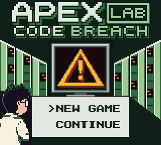
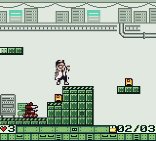
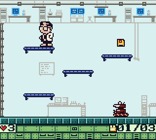
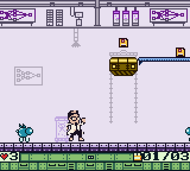
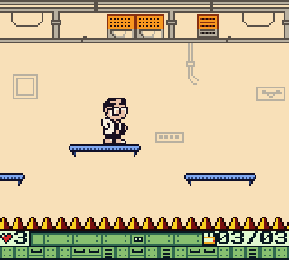
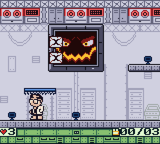
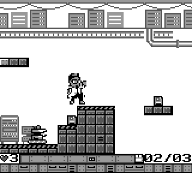

# ApexLab: Code Breach

A platformer for the Game Boy, written in C with [GBDK-2020](https://github.com/gbdk-2020/gbdk-2020).
One 128 KB ROM that plays in color on a Game Boy Color and in 4 shades on the original
Game Boy, tested on real hardware with a flashcart.

The AI security of the ApexLab programming facility has gone haywire. You are staff #042,
a programmer locked inside. Collect the code fragments (floppy disks) to open each
security gate, ride the elevator down through five floors, and upload the patch into the
mainframe AI, KERNEL.

| | | |
|---|---|---|
|  |  |  |
|  |  |  |

On the original Game Boy:



## The game

- **5 levels**, one new idea each: the Server Room (bots, pits, gates), the Code Testing
  Lab (one-way shelves), the AI Research Wing (lifts and chasing drones), the Network Hub
  (spikes and cut cables) and the Mainframe, where KERNEL waits.
- **3 sections per level.** Each security gate needs a quota of fragments; extras are a
  bonus. An opened gate is your checkpoint.
- **Forgiving:** 3 lives, refilled every level. A lost life puts you back at the last
  gate with your fragments kept; game over lets you continue from that section.
- **Passwords** instead of saves: every level complete screen shows one, and CONTINUE on
  the title takes you back.
- Music and sound effects by Tronimal, parallax backgrounds, fades, a little story told
  on the elevator rides, and a demo that plays itself when the title screen waits a
  minute.

## Controls

| Button | In the game |
|---|---|
| ← → | Run |
| A | Jump (hold it to jump higher) |
| ↓ + A | Drop through a thin platform |
| ↑ | Upload the patch at a lit terminal (level 5) |
| START | Pause |

On the password screen the d-pad picks a letter, A types it and B erases one.

**Cheats** (for playtesting, they stay in): while paused, hold A and press SELECT to skip
to the next level, or hold A and press B to turn no-death on or off.

## Play it

- **In an emulator:** download `ApexLab.gb` from the releases and open it in any Game Boy
  emulator ([Emulicious](https://emulicious.net/), [SameBoy](https://sameboy.github.io/),
  [mGBA](https://mgba.io/), ...). It runs in color in Game Boy Color mode.
- **On a real Game Boy:** copy `ApexLab.gb` to a flashcart (EverDrive or a clone) and
  start it. It's a plain MBC5 cartridge without save RAM, so any flashcart that runs
  MBC5 games works. It was played through on a Game Boy Color with an EverDrive clone.

## Build it

You need [GBDK-2020 4.5.0](https://github.com/gbdk-2020/gbdk-2020/releases/tag/4.5.0)
unpacked into `gbdk/`, GNU Make and Python 3.13. On Windows, `make` works from
PowerShell, cmd and Git Bash.

```bash
make release
```

That builds `release/ApexLab.gb`. `make` builds the development ROM `obj/ApexLab.gb`
(it skips the intro and title, for the tests). The tests need a Python environment:

```bash
make venv
```

```bash
make test
```

The tests run the ROM headless in [PyBoy](https://github.com/Baekalfen/PyBoy), in both
Game Boy and Game Boy Color mode: they replay every level, check the physics, the
palettes, the passwords and the frame budget, and compare screenshots.

## How it works

[docs/ARCHITECTURE.md](docs/ARCHITECTURE.md) explains how the game runs on the hardware:
ROM banking, streaming a wide level through a 32-tile map, the jump physics in integer
math, the parallax screen splits, palettes and fades on both Game Boys, music and sound
effects, the passwords and the demo, with where each idea came from. The game itself,
and how to make levels, is in [docs/GAME_DESIGN.md](docs/GAME_DESIGN.md). The rest of the
docs are listed in
[docs/README.md](docs/README.md).

## Credits

- **Code, design and art:** Handcrafted by Norbert Ruff in 2024-2025, using tutorials like [laroldsjubilantjunkyard.com](https://laroldsretrogameyard.com/) the in 2026 resurrected with [Claude Code](https://claude.com/claude-code)
  Art redrawn by hand on the 8×8 grid from references made with Claude
  Design and Gemini, finished in Aseprite.
- **Music:** Tronimal, [Game Boy Music Pack](https://yogi-tronimal.itch.io/game-boy-music-pack)
  and [Game Boy Music Pack #2](https://yogi-tronimal.itch.io/game-boy-music-pack-2), CC BY 4.0.
- **Sound effects:** Tronimal, [GBFX](https://yogi-tronimal.itch.io/gbfx) and
  [GBFX2](https://yogi-tronimal.itch.io/gbfx2), CC BY 4.0.
- **Music driver:** [hUGEDriver](https://github.com/SuperDisk/hUGEDriver) by SuperDisk,
  public domain.

Every third-party item with its license and changes: [CREDITS.md](CREDITS.md).

## License

- The code (`src/`, `tools/`, `tests/`, the `Makefile`): [MIT](LICENSE).
- The game's own art (`graphics/`) and levels (`levels/`):
  [CC BY 4.0](LICENSE-ART).
- The music and sound effects keep their own CC BY 4.0 license, and hUGEDriver is public
  domain ([CREDITS.md](CREDITS.md)).

## About me

Hi, I'm Norbert, a developer at Apex Lab Hungary. I like to tinker with old technology;
this game started as a way to learn C on the Game Boy.

[](https://www.linkedin.com/in/ruff-norbert-6b167b204/)
[](mailto:ruffnorbert88@gmail.com)
